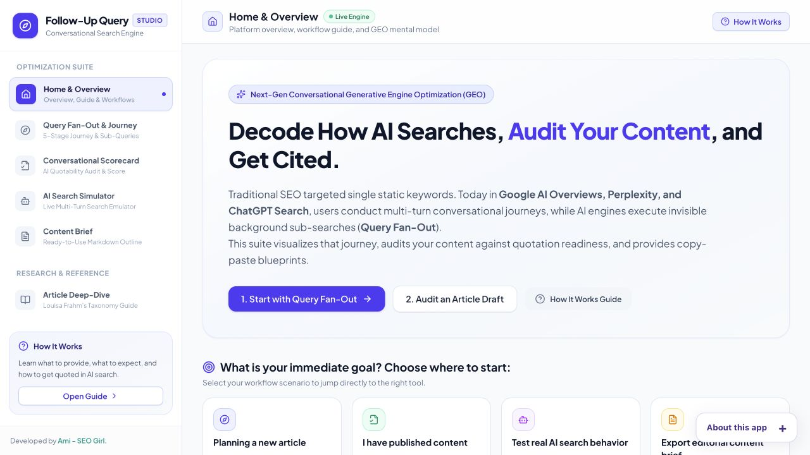

# Follow-Up Query Studio

Explore the questions that follow an initial search, and turn those journeys into content decisions.

Built by [Ami Saeednia](https://www.seogirl.ca), SEO / GEO Strategist.

[Live app](https://seogirl-follow-up-query-studio.vercel.app/) · [Research and studies](https://www.seogirl.ca/research/the-follow-up-gap) · [All tools](https://www.seogirl.ca/apps)

## The problem

Explore the questions that follow an initial search, and turn those journeys into content decisions.

## Who it is for

SEO strategists, editors and researchers studying conversational search.

## Workflow and methodology

Build or inspect a topic journey, examine follow-up branches, use the scorecard and simulator, and turn the gaps into a content brief.

## Evidence and limitations

Generated follow-ups model plausible user needs. Grounding metadata, when returned, records what the configured provider exposes; it does not reveal Google’s internal fan-out or every AI platform’s reasoning. Sample topics remain useful without a live model call.

The screenshot documents the interface, not an independently validated result. This repository is a practical research tool; its outputs require human review.

## Local setup

Server-backed React / TypeScript app. Run `npm install`, then `npm run dev`. The development server uses port 3000. For live generation, provide `GEMINI_API_KEY` to the server environment (for example a local `.env` file; never commit it). Without a working key, inspect the built-in sample experience. Use `npm run lint` for TypeScript checking and `npm run build` for the production bundle. On Vercel, configure the key as a server environment variable and redeploy.

Review `package.json` for the exact scripts and dependencies. Do not put secrets in frontend code or commit local environment files.

## Background

I build tools to make entity strategy, technical SEO and AI-search research easier to inspect and apply. Explore my [independent studies](https://www.seogirl.ca/research), [workbooks](https://www.seogirl.ca/workbooks) and [project case studies](https://www.seogirl.ca/case-studies).

## Concept credit

The conversational-search framing builds on Louisa Frahm’s “The Follow-Up Query: Rethinking SEO for Conversational Search.” Generated journeys are hypotheses to investigate, rather than observed user behavior by default.
